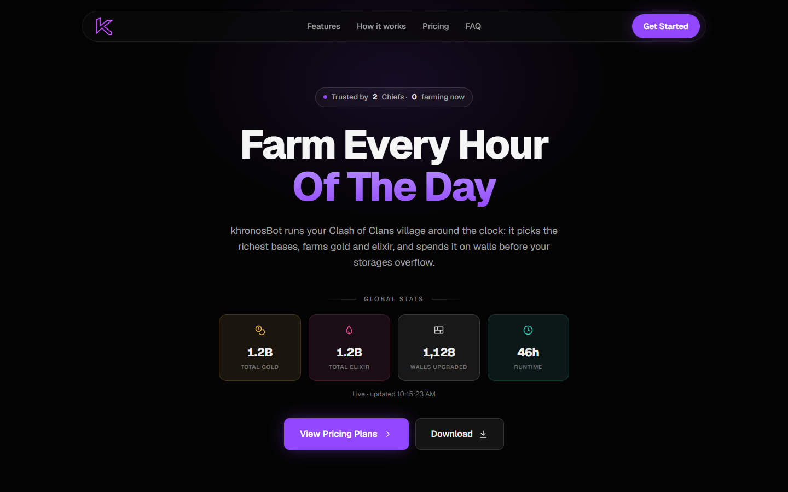
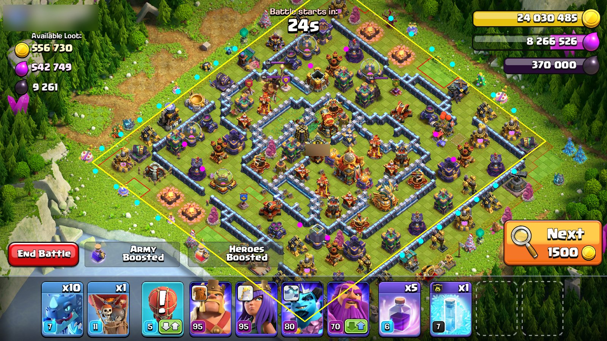
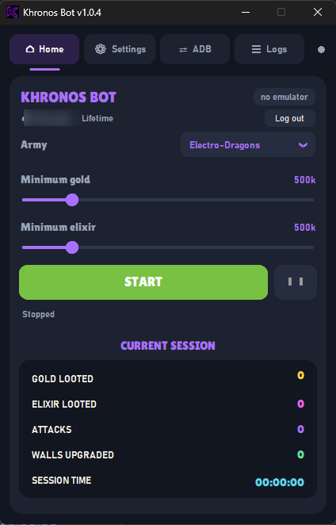
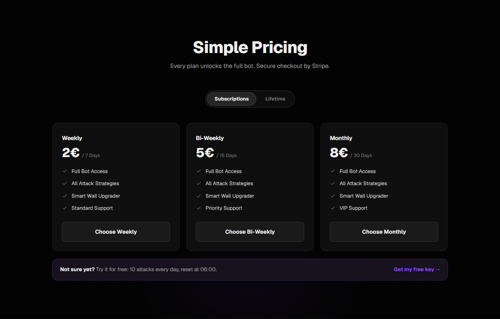

# khronosBot

### ⚔️ The Clash of Clans farming bot that works while you sleep

Finds the richest bases, farms gold & elixir, and spends it on walls — 24/7, on MuMu Player.

**[🌐 Website](https://khronosbot.netlify.app)** &nbsp;·&nbsp;
**[⬇️ Download](https://github.com/Tchocapik/khronos-bot-releases/releases/latest/download/KhronosBot-Setup.exe)** &nbsp;·&nbsp;
**[🎁 Free key](https://khronosbot.netlify.app/free.html)** &nbsp;·&nbsp;
**[💬 Discord](https://discord.gg/ceFTuYJTcD)**

 

---

## ✨ Features

| | |
|---|---|
| 🎯 **Loot-first base hunting** | Reads the loot of every base and only attacks when gold *and* elixir beat your minimums. |
| 🧱 **Auto wall upgrades** | Storages almost full? It spends gold and elixir on the cheapest walls first. Never touches your gems. |
| 🔴 **Red zone detection** | Finds the real deploy border of each base and drops troops right outside it — nothing wasted. |
| 🧠 **Human-like play** | Random sides, troop order, tap positions and delays, plus short and long breaks. No two attacks look the same. |
| 🖥️ **Multi-account** | One window per MuMu emulator, each with its own settings. Farm several villages at once. |
| 📊 **Live loot tracking** | Gold, elixir, walls and runtime for your session — and global stats live on the website. |
| 🔄 **Auto updates** | The bot tells you when a new version is out and installs it in one click. |

 

 
Red zone detection: the yellow border and the deploy points are found automatically on every base.
  

---

## 🚀 Getting started

**1. Install MuMu Player 12**
Tablet mode, resolution **1600×900**, ADB enabled (Settings → Other). No root needed.

**2. Download khronosBot**
Grab **[KhronosBot-Setup.exe](https://github.com/Tchocapik/khronos-bot-releases/releases/latest/download/KhronosBot-Setup.exe)** and run the installer.

**3. Get a key**
- 🎁 **Free** — connect Discord on **[the free page](https://khronosbot.netlify.app/free.html)** and get your key instantly.
- 💎 **Premium** — pick a plan on **[the website](https://khronosbot.netlify.app/#pricing)**, your key is sent by DM right after payment.

**4. Sign up and press Start**
Open khronosBot → **SIGN UP** → choose a username + password → paste your key → **CREATE ACCOUNT**.
Pick your emulator, your army and your minimum loot, then hit **START**. That's it. 🌾

 

  

---

## 💎 Plans

| Plan | Price | Duration | Attacks |
|---|---|---|---|
| 🎁 **Free** | 0 € | Forever | 10 per day (reset at 06:00 Paris time) |
| ⚡ **Weekly** | 2 € | 7 days | Unlimited |
| 🔥 **Bi-Weekly** | 5 € | 15 days | Unlimited |
| 👑 **Monthly** | 8 € | 30 days | Unlimited |
| ♾️ **Lifetime** | 35 € | Forever | Unlimited |

Every paid plan unlocks the full bot. Secure checkout by **Stripe**, plus the **Premium** role on Discord.

 

  

---

## 🖥️ Requirements

- Windows 10 or 11 (64-bit)
- [MuMu Player 12](https://www.mumuplayer.com/) — tablet mode, 1600×900, ADB enabled
- Clash of Clans installed in the emulator
- An internet connection (for your license key)

---

## ❓ FAQ

<b>Is there a free version?</b>

 
Yes. Every Discord account can get one free key with <b>10 attacks per day</b>, reset every day at 06:00 (Paris time). Get it on <a href="https://khronosbot.netlify.app/free.html">the free page</a>.

<b>I paid but didn't get my key in DM</b>

 
Your key is also shown on the payment confirmation page. If your DMs are closed, reconnect Discord on the checkout page to see your unused keys, or ask on <a href="https://discord.gg/ceFTuYJTcD">Discord</a>.

<b>Can I run several accounts?</b>

 
Yes. Open one khronosBot window per MuMu emulator. Each window keeps its own settings.

<b>Where is the source code?</b>

 
This repository only hosts the official installers. Always download khronosBot from here or from <a href="https://khronosbot.netlify.app">the website</a>, never from anywhere else.

---

## 💬 Support

Questions, bugs or ideas? Join the community on **[Discord](https://discord.gg/ceFTuYJTcD)**.

If you like khronosBot, a ⭐ on this repo helps a lot!

---

khronosBot is not affiliated with, endorsed, sponsored, or approved by Supercell. 
Using third-party automation may go against the game's Terms of Service. Use it at your own risk.

